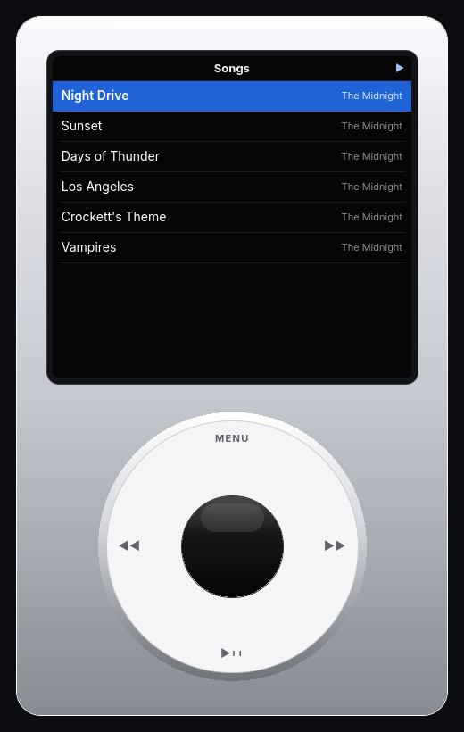

# Click

A classic click-wheel player. The screen and the wheel are Click. Apple Music
plays behind them after one sign-in on this machine.

You need an Apple Music subscription and a network connection. Playback is the
regular stream, not Lossless, and songs are not kept for offline listening.

| Key | Action |
| --- | --- |
| Wheel, ↑ ↓ | Move |
| Center, Enter | Choose |
| Menu, Esc | Back |
| Space | Play or pause |
| ← → | Previous or next |
| − = | Volume |
| ? | Shortcuts |
| Q | Quit |
