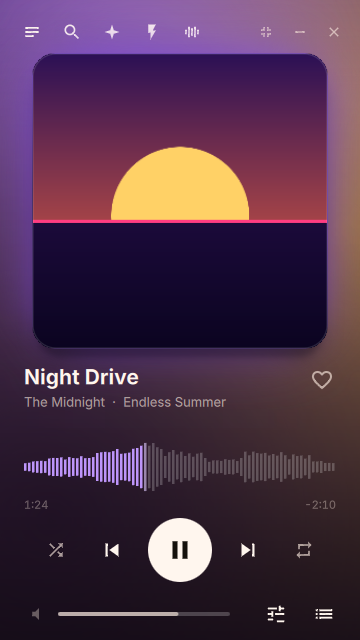
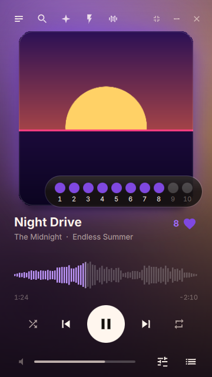
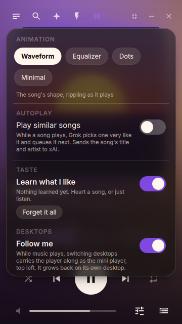
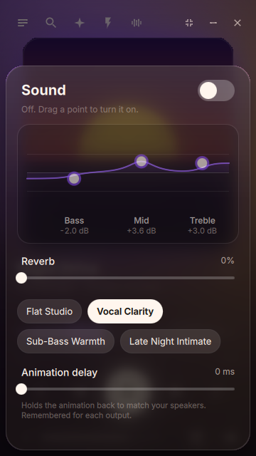
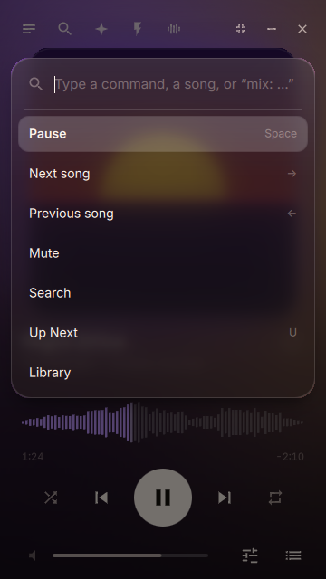
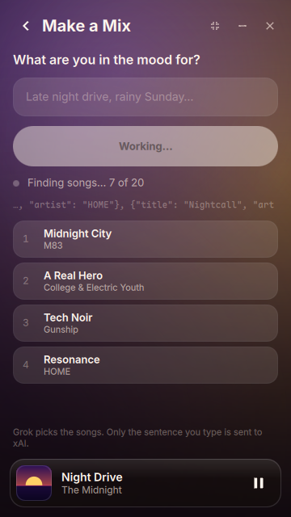
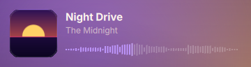

# Music Player

A beautiful mini player for Apple Music on Linux. Search, queue and play your
music from a small, fast window of frosted glass that takes its colors from
whatever is playing, and moves with the music.

**New here? Follow [INSTALL.md](INSTALL.md): it walks through every step.**

You need an Apple Music subscription and a network connection. Playback is the
regular stream, not Lossless, and songs are not kept for offline listening.

  
  

## What it does

- **It moves with the music.** The player listens to its own audio (levels
  only, nothing is stored or sent) and the whole window follows it. The bars
  have springs and shimmer with the spectrum; every kick sends a wave out from
  the playhead; hats sparkle and snares flick; the backdrop flares on the beat.
  The album cover follows the bass: it swells and sends out a ring on strong
  bass hits and ignores small wiggles, but in a passage with no bass it becomes
  very sensitive to everything else. It breathes between 1.00 and 1.03 on a
  spring, and on a really big hit its edge splits into a red and cyan fringe
  that fades over 400 ms. It works at any volume. If it cannot listen (no PipeWire tools), it animates on
  its own instead.
- **In time with your speakers.** Bluetooth plays sound a moment after the
  computer sends it, so the animation is held back to match (starting at about
  180 ms for Bluetooth, and adjustable under **Sound ▸ Animation delay**,
  remembered for each output). Or press **Tap to sync** and tap the pad (or
  Space) on each kick you hear: after 8 taps the delay is set from the median
  gap between the kicks the player heard and your taps, ignoring stray taps.
  Nothing extra is played.
- **A heart that learns.** Tap the heart by the title for "I enjoy this" (an 8
  out of 10), or hover it for a 1 to 10 scale. Not hearting a song means
  nothing, and a low rating (3 or 4) only means "enjoyed less than the others",
  never "dislike": only repeated 1s and 2s, or many quick skips, make an artist
  one to avoid. The player also notices what you skip and what you play to the end.
  All of it is kept as small running totals that fade over time (one file, a few
  KB), and Grok is told the clear parts when it makes a mix. **Options ▸ Taste**
  switches it off or forgets it all.
- **Similar songs, if you want them.** Turn on *Play similar songs* (the bars
  icon in the top bar, or Ctrl+K) and when a song is the last one in your queue,
  Grok picks songs very like it and the first one Apple Music has plays next,
  song after song, until you turn it off. It never interrupts a playlist or a
  mix, skips songs that already played, and retries when a suggestion is not on
  Apple Music. Off until you turn it on: it sends the song's title and artist
  (and your taste summary, while learning is on) to xAI.
- **Artists, albums, tracks.** Search shows artists first. Open one for their
  top songs and albums (newest first); open an album for its tracks under a
  *Play album* row; play a track and the album carries on from there.
- **Follows you across desktops (Hyprland).** While music plays, switching
  desktops carries the player along as the mini player, top left. Drag it
  somewhere else and that is where it stays on other desktops and parks next
  time. It grows back, in its old place, on its own desktop. **Options ▸
  Desktops** switches it off.
- **Colors from the cover.** Three colors are read from every cover and drift
  behind the player as a slow mesh. They ease to the next song's colors over
  800 ms.
- **A waveform time bar.** Hover for a bead and the time left from that spot;
  drag and the playhead follows on a spring and sticks lightly to the quiet
  moments between phrases (hold Shift to switch that off).
- **Animation styles.** The bars icon in the top bar (or Ctrl+K, "animation")
  switches the time bar between Liquid (the default: one continuous glowing
  ribbon through the waveform; kicks ripple along it, snares make it bounce,
  hats make its edge shimmer), Waveform, Equalizer (a spectrum analyser with
  peak caps), Dots and Minimal. Remembered.
- **Mixes in one click.** Open search with nothing typed and chips offer a mix
  for the time of day, "More like" your two most-liked artists, and "Surprise
  me". One click and Grok starts making it.
- **Liquid Glass.** Sheets are lit glass: 8% white over a 48px blur, a rim
  bright at the top-left fading to the bottom-right, a deep soft shadow. When a
  sheet opens the player behind steps back (to 96%) and blurs a little more.
  Switches are liquid (the thumb stretches as it flicks across), play and pause
  morph into each other, buttons squeeze to 92% when pressed, one hover glow
  glides from row to row (rows lift 1px, their actions slide in one after the
  other), the Sound curve glows where the music is loud, and the cover flies
  between the big player and the mini player as the window morphs.
- **Ctrl+K runs anything.** Type a few letters of a command ("mute", "bass
  boost", "mini"), a song to search for, or `mix: synthwave rainy night`.
- **Make a Mix with Grok.** Type a mood, or tap one of the suggestions made for
  this hour and day ("Midnight code session"). Songs appear one by one as Grok
  writes its answer. Click finds them on Apple Music, plays them, and can save
  the mix to your library. Only the sentence you type, and your taste summary,
  are sent to xAI.
- **Sound.** A three-band EQ you shape by dragging points on its curve, a
  reverb amount, and four presets. It shapes only this app's audio through a
  PipeWire filter chain, with no effect on anything else.
- **Mini mode.** A compact bar with art, song and waveform; the controls appear
  when the pointer arrives. `Ctrl+M`.
- **A real desktop citizen.** Media keys and `playerctl` work (MPRIS, including
  loop and shuffle), the tray icon has the transport and a few jumps through
  the song, the window remembers its place, and it can stay on top.

  
  

  
  

  

## Keys

| Key | Action |
| --- | --- |
| Space | Play or pause |
| ← → | Previous or next |
| − = | Volume |
| ↑ ↓, Enter, Esc | Move, choose, back |
| Ctrl+K | Run any command |
| H | Heart the song (8/10); again to take it back |
| A / N | Add to Up Next / play next |
| U | Up Next |
| M | Make a mix with Grok |
| T | Always on top |
| Ctrl+M | Mini player |
| F11 | Full screen: the big cover and the synced lyrics (Esc leaves) |
| ? | Shortcuts |
| Q | Quit |

## Install

    bin/local-install

Builds the app and adds **Music Player** to your app launcher (user install, no
root). For an Arch package use `bin/install`.

Needs Qt 6 (declarative, webengine, webchannel). The EQ and reverb need PipeWire
with `pw-cli` and `pactl`; following the music also needs `parec`. Make a Mix
and similar songs need the [Grok CLI](https://x.ai) signed in. The tray icon
needs a tray in your bar, and `qt6-svg` to draw its icon. Following you across
desktops needs Hyprland. Everything else works without them.

## How it is built

| File | What it is |
| --- | --- |
| `src/MainWindow.qml` | The window: shortcuts, the Apple Music session, the tray, the mini-mode morph |
| `src/Player.qml` | The screens: now playing, library, Make a Mix, mini, welcome, heart, options |
| `src/MeshBackground.qml` | The drifting colour mesh behind everything |
| `src/LiquidScrubber.qml` | The time bar (hover bead, drag, seeking) around the native bars |
| `src/GlassPanel.qml` | Frosted glass: live blur, milk, light spill, gloss, lit rim, shadow |
| `src/LiquidSwitch.qml`, `src/PlayPauseGlyph.qml` | The liquid toggle; play/pause as one morphing shape |
| `src/AdvancedSoundStudio.qml` | The Sound studio: simple 3-band or advanced 10-band EQ, live spectrum, presets, animation delay |
| `src/HeaderPlusPill.qml`, `src/ActionDropdown.qml` | The "+" in the header and its acrylic menu: Liked Songs, Add to Playlist (your own playlists only), Add to current playlist, New Playlist |
| `src/LyricsView.qml`, `src/FullScreenLyricsView.qml`, `src/lyrics.*` | Synced lyrics (TTML, LRC, plain) and the full-screen cinema view |
| `src/CommandPalette.qml` | Ctrl+K, including described sounds ("muffled club bathroom", "crisp acoustics") that become EQ settings |
| `src/Glass.qml` | Every colour, blur radius and spring in one place, and the frame clock |
| `src/audiolevels.*` | Listens to this app's own stream: spectrum, level, onsets (kick, snare, hat), delay to match the speakers |
| `src/wavebars.*` | Draws the time bar's bars as one scene-graph node, with a spring per bar |
| `src/taste.*` | What the hearts, skips and plays teach: scores that fade, size caps, the profile sent to Grok |
| `src/desktop.*` | Follows you across Hyprland desktops through `hyprctl` and its event socket |
| `src/waveform.*`, `src/commands.*` | The waveform shape and the palette's fuzzy matching |

Apple's audio is DRM-protected inside the page, so its samples cannot be read
there. But once it plays it is an ordinary stream on PipeWire, and `parec
--monitor-stream` taps that one stream without changing what you hear. The
levels come from that. The waveform's *shape* is still a stand-in (the real
peaks are not available): a song-like shape (intro, verses, louder choruses, a
quieter bridge, an outro) seeded from the track, so a song always looks the
same; the *movement* on top of it is the real music.

How it stays on the beat: a kick is found as the sudden rise of a low-passed
bass envelope, a snare and a hat as sudden rises across their bands, each judged
against the last second so a steady bass line is not mistaken for beats. On a
synthesized loop the real listener finds every kick, a half second apart; on test
tones every kick lands within two frames of the onset. What is shown is advanced
once per drawn frame with the real elapsed time, so it is smooth on any screen.

### Design tokens (`src/Glass.qml`)

| Token | Value |
| --- | --- |
| Text | `#fff6ee`; secondary `#f8e7dc` at 65%; hints at 36% |
| Base behind everything | `#100d0a` |
| Glass fill | `#f8e7dc` at 12%, 20% under the pointer |
| Specular edge | 1px `rgba(255, 255, 255, 0.14)` |
| Panel gloss | white 10% at the top edge, fading out by 35% of the height |
| Panel glass | white 8% over a dark shade (`#140f0c` at 45%) over the blur |
| Panel rim | 1px, white 22% top-left, 10% midway, 4% bottom-right |
| Panel blur | 48px radius, saturation +0.3, drawn at half resolution |
| Panel shadow | black 45%, 32px blur, 24px down, corner radius 26 |
| Behind an open sheet | the player scales to 96% and blurs by 8px |
| Scrim behind sheets | black 55% |
| Colour change between songs | 800 ms, ease in-out sine |
| Spring, things that pop (buttons, chips, the time capsule) | spring 4.0, damping 0.22 |
| Spring, panels and sheets | spring 3.0, damping 0.28 |
| Spring, the window morph to mini | spring 3.4, damping 0.42 |
| Spring, playhead while dragging | spring 5.0, damping 0.38 |
| Spring, the + pill and lyric lines (brief: stiffness 450, damping 22, mass 1, so zeta 0.52) | spring 4.5, damping 0.22 (calibrated by eye against the bounce spring, not derived) |
| Spring, snappy (switch thumb, press squeeze to 0.92, play/pause morph) | spring 7.0, damping 0.32 |
| Cover breathing | 1.00 to 1.03, spring 9, damping 0.38; fringe 400 ms, out-cubic |
| Spring, a bar rising / falling | stiffness 520, damping ratio 0.65 / stiffness 190, damping ratio 0.9 |
| Beat wave along the bars | 70 bars a second, 3.5 bars wide, fading over 0.5 s |
| Audio frame clock | once per drawn frame while a song plays; stopped when nothing is playing |

### Staying light

The backdrop is four GPU-drawn gradients, not a blur. The glass blur only runs
while a sheet is open, and its texture is released when it closes. The bars are
one native item rather than a QML object per bar. Nothing listens, and nothing
redraws, while a song is paused or the window is hidden. Measured on the
preview (the player UI without the Apple Music page, with a made-up groove
standing in for the audio): 0% of a core paused; about 6 to 7% of one core
playing, which is the whole window redrawing at the screen's rate to follow the
beat. Without audio to follow it falls back to about 2.6%. With vsync switched
off (frames drawn as fast as possible, a worst case) it is 5 to 19% playing,
and about 40% while a sheet is open, because the step-back blur then runs over the
whole window every frame. That cost ends when the sheet closes.

## Develop

    bin/build         # build
    bin/test          # unit tests, QML tests, and the page script's tests (needs node)
    CLICK_FX_LIVE=1 CLICK_MIX_LIVE=1 bin/test   # also test against real PipeWire and Grok

The live tests play into a throwaway virtual output, so they are silent, except
`effectsLiveRoutingOnThisMachine`, which plays a quiet tone on the real output.

`CLICK_PREVIEW=1` renders the UI with fixture data and no network, useful for
screenshots: add `CLICK_PREVIEW_NOW=1` for the player, `CLICK_PREVIEW_MINI=1`,
`CLICK_PREVIEW_MIX=1`, `CLICK_PREVIEW_OUT=1` for the welcome screen,
`CLICK_PREVIEW_PAUSED=1`, `CLICK_PREVIEW_ART=cover.png` for a cover, and
`CLICK_SHOT=out.png` to save a frame. `CLICK_PREVIEW_PANEL` opens one thing:
`sound`, `palette`, `heart`, `styles` (or `styles-desktop`), `style-bounce` (or
`-waveform`, `-dots`, `-minimal`), `scrub` (the time bar as if hovered), `morph` (switches to
mini after a second), `flight` (the cover frozen half way to mini), `discover`
(search with the mix chips), `tray` or `desktop`.

About the motion numbers: a design spec's "stiffness 400, damping 25" is not
what Qt takes. QML's `SpringAnimation` uses `spring` and `damping` (the values
in the table), and the native bars use stiffness and a damping ratio. The values
here were tuned by eye to the same feel: quick, one small overshoot, no wobble.
The spec's `LiquidWaveformScrubber`, `FrostedGlassSheet` and `LivingMeshBackground`
are `LiquidScrubber.qml`, `GlassPanel.qml` and `MeshBackground.qml` here. Preview makes up a steady 120 bpm
groove in place of the audio, and never moves or pins a window, except with
`CLICK_DESKTOP_TEST=1 CLICK_PREVIEW_PANEL=desktop`, which carries the preview window
away and home as a desktop switch would, so its geometry can be watched with
`hyprctl clients -j` (it pins the window, so it shows on the desktop you are on).

The offscreen platform uses Qt's software renderer, which cannot draw blur or
masked images, so take screenshots with a real display.

### What is verified, and what is not

Added with the studio, the + menu, lyrics and full screen. Verified: the ten-band
graph loads in the real PipeWire and moves live (`CLICK_FX_LIVE=1`); the volume
and playlist commands and the lyrics lookup against a fake MusicKit; the TTML,
LRC and plain-text parsers on fixtures; every new screen as a real GPU frame.
Not verified without a signed-in session: that Apple's `/lyrics` endpoint answers
for your account, that adding a song to a playlist you made in Apple Music is
allowed (if not, only the playlists Click made can take songs), which volume
property the live MusicKit honours (both are set), and the real full-screen
round trip (the window going full screen and back to 360 px) on Hyprland. A
screenshot cannot go real full screen, so `CLICK_PREVIEW_PANEL=cinema` renders the
view in a large window instead.

Verified: the analyzer on generated tones and a synthesized musical loop; the
real listener on a real PipeWire stream; the page script (`src/pod.js`) against
a fake MusicKit; Grok's replies for mixes and similar songs; Hyprland's pin and
move commands on a hidden window.

Not verified against a real signed-in Apple Music session: that Chromium's own
stream is found the same way (its process is a child of this app, as the lookup
expects), Apple's catalog paths for artists, albums and top songs (written from
the API's documented shape, with errors shown instead of an empty list), and
`playNext` and `startWith` behaviour in the live player. Following you across
desktops: its decisions are unit-tested, and the whole carry-away and come-home
sequence was watched on a preview window (it ends at exactly the corner, and back at
exactly the original position); a real switch of desktops was not run.

---

Music Player is an unofficial hobby project. It is not made by, or affiliated with, Apple. "Apple Music" is a trademark of Apple Inc.
