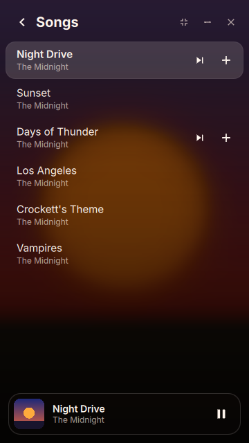

# Music Player

A beautiful mini player for Apple Music on Linux. Search, queue and play your
music from a small, fast window that takes its colors from whatever is playing.

You need an Apple Music subscription and a network connection. Playback is the
regular stream, not Lossless, and songs are not kept for offline listening.

  
  

## What it does

- **Colors from the cover.** Every song tints the whole window, and changes
  fade smoothly from one song to the next.
- **Search and Up Next.** Find any song, album or playlist. Hover a row to play
  it next or add it to the queue.
- **Make a Mix with Grok.** Type a mood ("late night drive") and Grok picks
  about 20 songs. Click finds them on Apple Music, plays them, and can save the
  mix to your library. Only the sentence you type is sent to xAI.
- **Bass, treble and reverb.** A Sound panel shapes only this app's audio
  through a PipeWire filter chain, with no effect on anything else.
- **Mini mode.** A compact bar with art, progress and controls. `Ctrl+M`.
- **A real desktop citizen.** Media keys and `playerctl` work (MPRIS), the window
  remembers its place, and it can stay on top.

  
  

## Keys

| Key | Action |
| --- | --- |
| Space | Play or pause |
| ← → | Previous or next |
| − = | Volume |
| ↑ ↓, Enter, Esc | Move, choose, back |
| A / N | Add to Up Next / play next |
| U | Up Next |
| M | Make a mix with Grok |
| T | Always on top |
| Ctrl+M | Mini player |
| ? | Shortcuts |
| Q | Quit |

## Install

    bin/local-install

Builds the app and adds **Music Player** to your app launcher (user install, no
root). For an Arch package use `bin/install`.

Needs Qt 6 (declarative, webengine, webchannel). Bass, treble and reverb need
PipeWire with `pw-cli` and `pactl`. Make a Mix needs the
[Grok CLI](https://x.ai) signed in. Everything else works without them.

## Develop

    bin/build         # build
    bin/test          # unit tests
    CLICK_FX_LIVE=1 CLICK_MIX_LIVE=1 bin/test   # also test against real PipeWire and Grok

`CLICK_PREVIEW=1` renders the UI with fixture data and no network, useful for
screenshots: add `CLICK_PREVIEW_NOW=1` for the player, `CLICK_PREVIEW_MINI=1`,
`CLICK_PREVIEW_OUT=1` for the welcome screen, `CLICK_PREVIEW_ART=cover.png` for a
cover, and `CLICK_SHOT=out.png` to save a frame.
